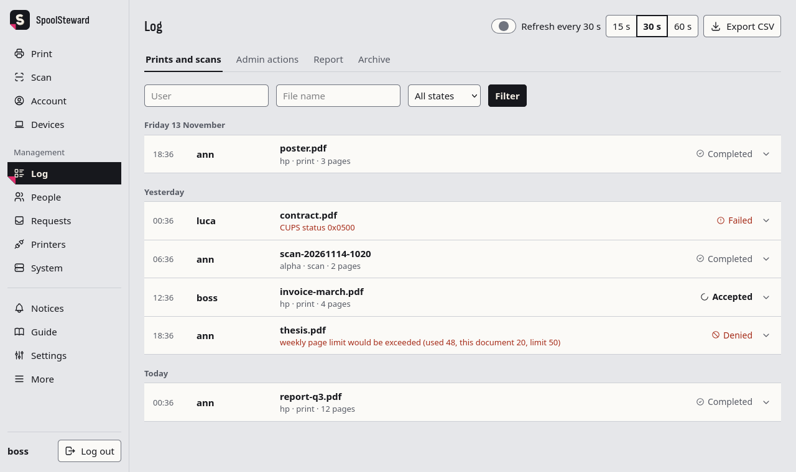

# Audit

[Documentation index](../README.md) · English · [Italiano](../it/audit.md)

SpoolSteward keeps **two append-only logs**:

| Log | Table | Content | Page |
|---|---|---|---|
| Print and scan audit | `job_log` | who printed or scanned what | **Log** → *Prints and scans* (`/admin/jobs`) |
| Administrative actions | `admin_audit` | who did what in the portal | **Log** → *Admin actions* (`/admin/actions`) |

Ids are never reused. **No portal function deletes a row.** Audit is kept forever.

## 1. Print and scan audit

Each row has: sequential number, time, user, device (printer queue or scanner), file name, type (print / scan), outcome, pages, rejection reason, and options (paper, colour, duplex, source, copies, page range, comment, `via` web / IPP…).

**The file name** can stop being saved with the *Save file names* switch in *System*; with retention (`.env`) it disappears after a number of days you choose. The row always stays. Details: [data-protection.md](data-protection.md).

| State | Meaning |
|---|---|
| `accepted` | Passed the checks and was handed to CUPS or the scanner. **Already counts toward quota.** |
| `completed` | Finished; the pages are the **real** ones read from CUPS |
| `held` | Held in the queue; counts toward quota |
| `denied` | Refused (quota, permission, block, maintenance, disabled account). Does not count and uses no pages. The reason is stored (in English) |
| `failed` | Accepted but the printer or scanner could not carry it out. Does not count |
| `canceled` | Stopped before printing, by the user, an administrator or the scanning program. Quota is freed |

Rows are grouped by day (*Today*, *Yesterday*, then the weekday and date) and **open** when clicked: the detail has the number, the whole file name, the time with seconds, the options, the pages, the comment and the whole note with a copy button. A refusal or an error shows its reason in red in the row itself. The page has an **automatic refresh** switch with its interval beside it (15, 30 or 60 s; the choice is saved for you; with 0 the switch starts off and uses 30 s when turned on; the browser remembers the switch) and it does not reload while a row is open. Filters and **CSV export** are available. *Cancel print* is in the detail of a queued print (it uses the owner's identity). People see their own latest prints in *Account*.

Scans without credentials (anonymous eSCL) show the caller's IP and host name in the detail of the row. A scan made through a scan window shows the address it came from; a request refused because it came from another address than the window's is a *denied* row under the window's owner, and the detail shows both addresses.

### Usage report

*Report* (the third tab of the Log, page `/admin/report`) ranks users by pages printed in a period. Choose the period with a button (*Today*, *Last 7 days*, *This month*, *Last month*, *Last 30 days*, *This year*) or by typing two dates as `2026-10-31`, how many users to list, the groups to **leave out** and **Detailed report**, which adds the prints per printer for each user.
Show it in the page or download **CSV** or **PDF**. Only prints count (completed, waiting or running). Rows already moved to a compressed archive are not read: the page warns when the period reaches back that far. The PDF is in English with standard fonts, so Cyrillic or Chinese names show as `?` there; the CSV keeps them.

## 2. Reconciliation with CUPS

Every 30 s the **reconciler** reads CUPS: a finished job becomes `completed` with its real pages; one canceled before printing returns its quota; reservations with no CUPS job for over 1 hour (gateway died mid-way) are released; a job gone from history for over a day is marked completed.

## 3. Administrative audit

Logged: `login` (administrators), `admin.setup` / `admin.set_password`, `user.*` and `group.*`, `password.change`, `key.*` (create, revoke, disable, enable, extend), `request.approve/reject`, `grant.create/revoke/purge`, printer controls (`printer.block/unblock`, `mdns_hide/mdns_show`, `keepalive_on/off/save`, `test_print`,
`debug_create`, `delete`, `move`, `rename`, `forget_name`, and by the system `auto_add` / `auto_remove`), `job.cancel` / `job.cancel_failed`, `jobtitles.on/off`, `backup.*`, `maintenance.on/off`, `audit.archive`, `archive.verify`, `notice.dismiss` / `notice.dismiss_all`, `update.request`.
Each entry keeps the actor's *name* (it survives deleting the actor), the action, the target and details. The page has filters with suggestions.

## 4. Archive

When the active tables exceed `SPOOLSTEWARD_AUDIT_MAX_MB` (default 25), the archiver (every `SPOOLSTEWARD_AUDIT_CHECK_INTERVAL`) moves the **oldest rows** to `data/audit-archive/audit-<table>-<from>-<to>.jsonl.gz`. Guarantees:

1. Rows of the quota windows still in play (previous and current month, plus margin) are **never** archived, so limits do not change.
2. The file is written as `.pending`, flushed, **read back and verified** (sha256).
3. Only then, in **one transaction**, the archive is registered in `audit_archive` (path, date and id range, rows, size, sha256) and the rows are removed.
4. The file is renamed and made read-only; an existing archive is never overwritten (a file left by a restored older backup is registered if it holds the same rows; otherwise it is kept aside as `….old-<date>` and a new one is written).
5. Memory stays small however many rows there are: they are read and written in groups of 5,000, and the size check counts the rows and weighs only the newest 500, so it is cheap on an SD card. The size shown in the portal is therefore an estimate.
6. An interruption anywhere loses nothing and duplicates nothing: `.pending` files are repaired or cleaned at restart.

The **Audit archive** page (`/admin/archive`) lists archives with the path in the container and on the host (`AUDIT_ARCHIVE_HOST_PATH`), size and sha256; opens them with search and pagination, **downloads** them and **verifies integrity** (it catches accidental changes; it is no proof against someone who can change both the database and the folder, because the sha256 is stored in the database). It can not delete them. `spoolsteward-admin audit-archive [--force]` runs the archiver by hand; `spoolsteward-admin jobs` shows the latest rows.

File names in the archive are encrypted only if you turned on the encryption of names ([data-protection.md](data-protection.md)); the portal decrypts them when it shows them and when you search. With retention on, rows past the limit are written without the name. Files already written are never modified, so names already in them stay.
The folder must be writable by the container user; it lives on the host, outside docker volumes, and is included in the backups ([backup.md](backup.md)).

## 5. Privacy

The database and the archives hold the names of printed files, which are personal data: protect `data/` and the volume accordingly.
