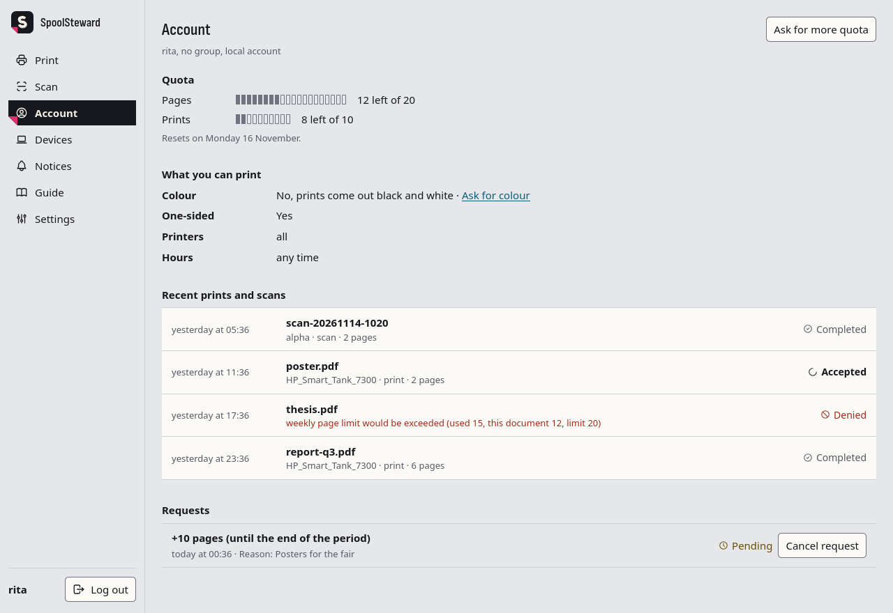
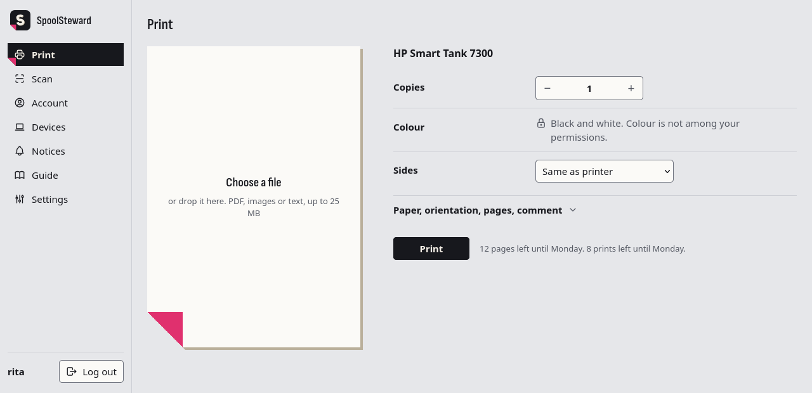
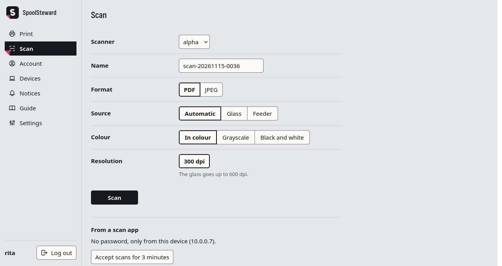
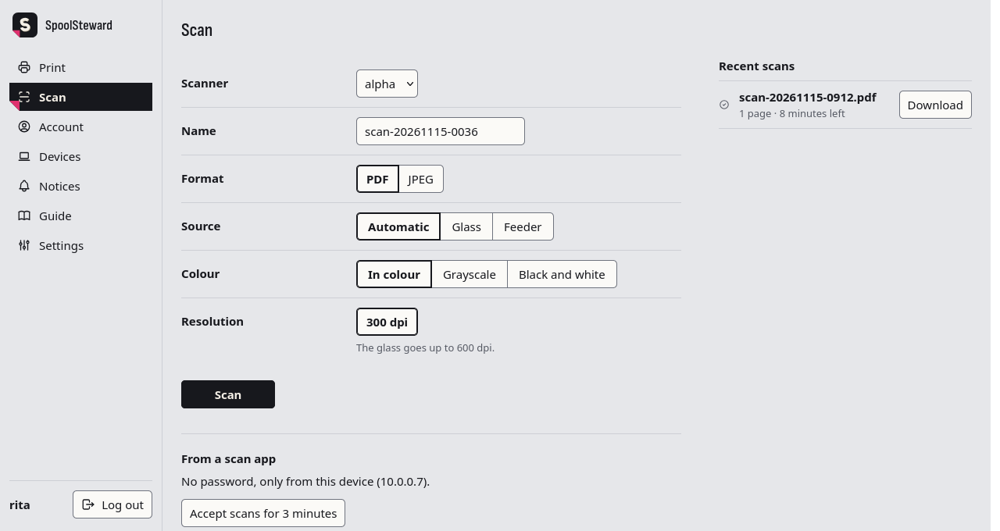

# User guide

[Documentation index](../README.md) · English · [Italiano](../it/guida-utente.md)

For people who print and scan. The portal is at `https://<server>:8631/`; the menu on the left has **Print**, **Scan**, **Account** and **Devices**, then **Notices**, **Guide** and **Settings** (administrators also get a *Management* group). On a phone the menu is a bar at the bottom: *Devices*, *Guide*, *Settings* and *Log out* are at the end of the *Account* page.

## 1. Sign in

Sign in with the account the administrator gave you (a local password), or with your office credentials if the installation uses RADIUS. A temporary password must be changed at the first login.

## 2. Account (`/me`) and Devices (`/me/keys`)

**Account** shows, from top to bottom:

- **Quota**: one line for each limit that applies to you (pages, prints): a tick for every unit (the used ones are filled), how many are left, and when they reset ("6 left of 20"; "6 left of 25 (20 + 5 granted)" with extra quota). *Ask for more quota* and *Ask to change group* are at the top right.
- **What you can print**: whether you may print in colour and one-sided, on which printers, at which hours. Without colour your prints come out in black and white; without one-sided, double-sided. Scanning is not affected. Next to what you lack there is an **Ask for…** link (and **Ask for another printer**): choose what you need, write why, and an administrator answers, permanently or until a date. While a request waits you see "Request sent". A permission that was granted until a date shows the date.
- **Recent prints and scans**: your last ten, with their state. A print that was refused or failed shows the reason in red, so you do not need to ask anybody.
- **Requests**: what you asked for, why, the state and the answer of the administrator. Up to 3 open requests by default; *Cancel request* withdraws one.

**Devices** is where a computer or phone is connected:

- **Keys**: create a key for each device (give it a name). It is shown **once**: copy it at once. Use it as the password when the computer or phone asks for credentials; the user name is yours (the page shows both, ready to copy). A key only prints and scans: it never opens the portal and your domain password is never needed on a device. *Revoke* a key (or all) if a device is lost. You choose how long it lasts (1 month to 2 years, or one print only); RADIUS users have a shorter maximum and renew by signing in again. The bell tells you when an administrator revokes, switches off or extends one.
- **Connect a device**: what to do on a phone or tablet, Windows, Linux and macOS; the guide for [Windows](windows.md) is step by step.

If a print is refused for quota, the message links to *Ask for more quota*. If it is refused because of your permissions (a printer you may not use, a time outside your hours, or colour / one-sided when the installation refuses instead of correcting), the notice links to **Account**, which shows what you may print. A print made in black and white or double-sided because of your permissions gets a notice too.

**Every refused or changed print gets its notice.** While one of the same kind is still open it is renewed instead of repeated: its time is updated, it shows how many times it happened (×3) and the bell lights up again, so a program that retries does not fill the list.

**Notices about changed prints.** The prints **forced** by your permissions (black and white, double-sided) are only information: they are marked as read by themselves after a while (*Settings* → "Mark as read after": 20 minutes by default, counted from the last such print; 0 = they stay until you dismiss them). They are not deleted: see *Show dismissed too*.
All other notices (refused prints, quota reached, keys, group, requests) stay until you dismiss them.

## 3. Print (`/me/print`)

On the left the **sheet** is the file: choose or drop a PDF, an image (JPEG, PNG, GIF) or a text file; it shows the name and size. On the right: the printer (a list when there is more than one; a printer that does not answer is shown, and can not be chosen), the **copies**, **colour** and **sides**. An option your permissions do not allow is not hidden: it says so, with the reason. *Paper, orientation, pages, comment* opens the rest: paper size (the sheet takes its shape), orientation, a page range (`1,5` or `2-4`) and an optional comment (50 characters, visible to administrators in the log).

Next to the *Print* button you see how many pages you have left until the quota resets. Same quota and log as every other print; it works from a phone with nothing installed. To connect a computer: [printing.md](printing.md).

## 4. Scan (`/me/scan`)

Choose the scanner, a name, the format (PDF or JPEG; with several sheets JPEG comes as a ZIP file), the source (automatic, glass or feeder), colour and resolution (300 dpi is selected; the glass may go higher). The sheet size the scanner takes and the limits of its feeder are reported by the scanner itself: see [scanning.md](scanning.md). You can leave the page while it scans and come back to download the file soon: it is kept 10 minutes unless the administrator changed it, and sooner if the server's scan memory is full. See [scanning.md](scanning.md).

When the scan is finished the file appears under *Recent scans* (beside the form on a wide screen), with the time left to download it and the *Download* button:

### Scanning from an app that cannot sign in

Most scan programs (NAPS2 and many others) cannot send a user name and password, so the gateway refuses them. If *Scan* has the section **From a scan app**, you can let your program in for a few minutes:

1. On the **computer where the scan program runs**, open *Scan* and press *Accept scans for 3 minutes*.
2. A box shows the address the server sees you at and a countdown (3 minutes unless the administrator changed it).
3. Start the scan in your program. Scans from that address are accepted as yours: your quota and permissions apply and they appear in the log under your name. You can scan as often as you like until the time ends; a scan already started is delivered even if the time runs out. *Close the window* ends it earlier.

A scan from a different address is refused, the audit records both addresses and your bell says so. Limits, because the gateway can only compare addresses:

- **NAT**: behind a router shared with other devices (another network, VPN, guest Wi-Fi) the server may see the same address for every device, so during the window those devices can scan too.
- **IPv4 and IPv6**: if the portal is reached over IPv6 and the scan app uses IPv4 (or the reverse), the addresses never match. Open the portal with the same kind of address the scan app uses.
- **Reverse proxy**: if you opened the portal through a proxy, the scan app will be refused (or, if it goes through the proxy too, any device behind it could scan). Open the portal directly on the server's port (`https://<server>:8631`) before pressing the button; the box warns you when it detects a proxy.

## 5. Settings (`/me/settings`: *Settings* in the menu)

- **Preferences**, with one *Save*: **theme** (like the system, light, dark), **language** (English, Italiano, Español, Русский, 中文; saved for your account) and the delay of the **notices about changed prints** (see above).
- **Change password** (local accounts), in its own section.

## 6. Good to know

- Your quota counts accepted, completed and held jobs; refused, failed and canceled-before-printing jobs are free. A pages limit is checked before printing: a document that does not fit is refused at once.
- Printers that do not answer, are blocked, or you may not use are not offered.
- If your hours are limited and it is outside them, the print page says when you can print, and a job sent anyway is refused.
