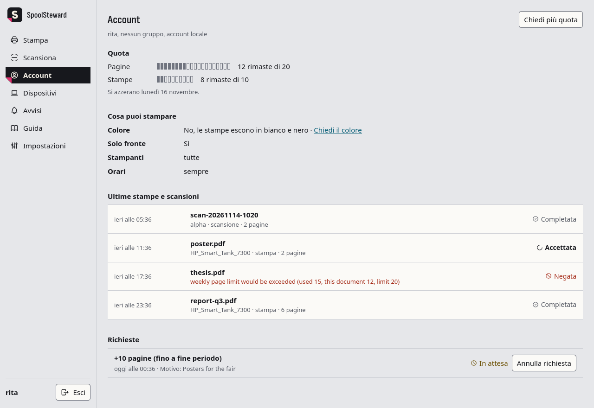
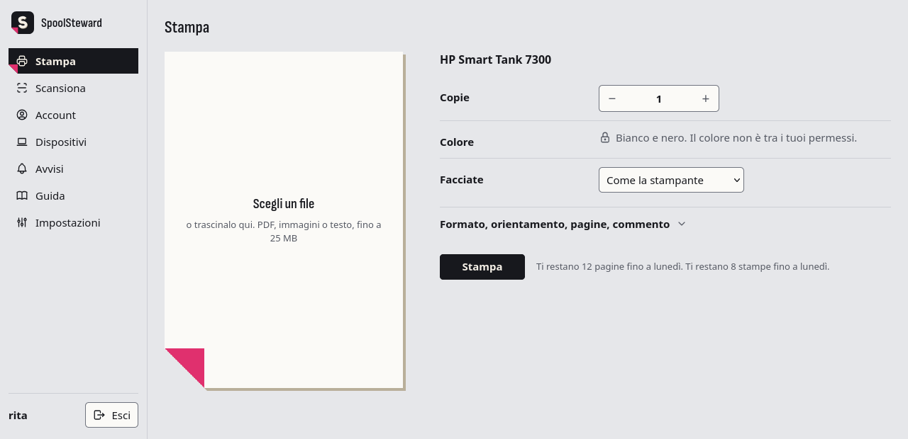
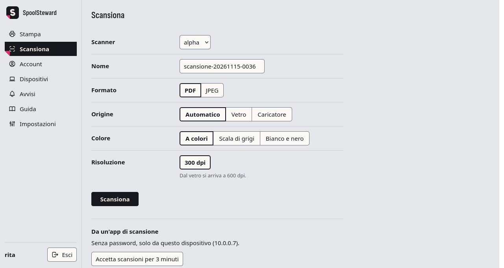
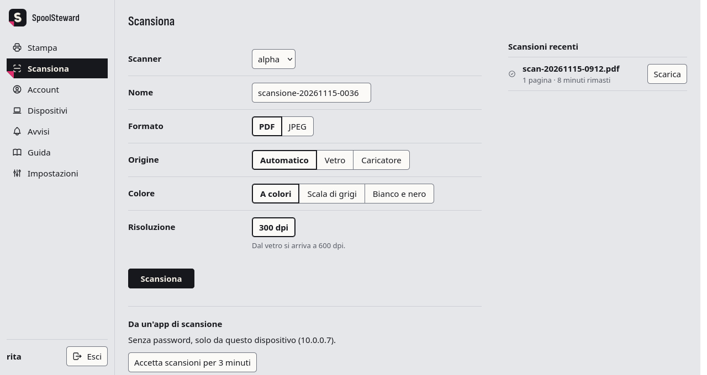

# Guida per l'utente

[Indice della documentazione](../README.md) · [English](../en/user-guide.md) · Italiano

Per chi stampa e scansiona. Il portale è su `https://<server>:8631/`; il menu a sinistra ha **Stampa**, **Scansiona**, **Account** e **Dispositivi**, poi **Avvisi**, **Guida** e **Impostazioni** (gli amministratori hanno anche il gruppo *Gestione*). Sul telefono il menu è una barra in basso: *Dispositivi*, *Guida*, *Impostazioni* ed *Esci* sono in fondo alla pagina *Account*.

## 1. Accesso

Entra con l'account che ti ha dato l'amministratore (password locale), oppure con le credenziali d'ufficio se l'installazione usa RADIUS. Una password temporanea va cambiata al primo accesso.

## 2. Account (`/me`) e Dispositivi (`/me/keys`)

**Account** mostra, dall'alto in basso:

- **Quota**: una riga per ogni limite che ti riguarda (pagine, stampe): una tacca per ogni unità (quelle usate sono piene), quante ne restano e quando si azzerano («6 rimaste di 20»; «6 rimaste di 25 (20 + 5 concesse)» con una quota extra). In alto a destra: *Chiedi più quota* e *Chiedi di cambiare gruppo*.
- **Cosa puoi stampare**: se puoi stampare a colori e solo fronte, su quali stampanti e in quali orari. Senza colore le stampe escono in bianco e nero; senza solo fronte, in fronte-retro. La scansione non cambia. Accanto a ciò che ti manca c'è un link **Chiedi…** (e **Chiedi un'altra stampante**): scegli cosa ti serve, scrivi perché, e un amministratore risponde, per sempre o fino a una data. Finché la richiesta aspetta vedi «Richiesta inviata». Un permesso concesso fino a una data mostra la data.
- **Ultime stampe e scansioni**: le ultime dieci, con il loro stato. Una stampa rifiutata o fallita mostra il motivo in rosso: non serve chiederlo a nessuno.
- **Richieste**: cosa hai chiesto, perché, lo stato e la risposta dell'amministratore. Fino a 3 richieste aperte di base; *Annulla richiesta* ne ritira una.

**Dispositivi** è dove si collega un computer o un telefono:

- **Chiavi**: crea una chiave per ogni dispositivo (dagli un nome). Si mostra **una volta**: copiala subito. Usala come password quando il computer o il telefono chiede le credenziali; il nome utente è il tuo (la pagina mostra entrambi, pronti da copiare). Una chiave serve solo a stampare e scansionare: non apre mai il portale e la tua password di dominio non serve mai su un dispositivo. *Revoca* una chiave (o tutte) se perdi un dispositivo. Scegli per quanto tempo vale (da 1 mese a 2 anni, o una sola stampa); gli utenti RADIUS hanno un massimo più corto e la rinnovano rifacendo il login. La campanella ti dice quando un amministratore revoca, disattiva o prolunga una chiave.
- **Collegare un dispositivo**: cosa fare su telefono o tablet, Windows, Linux e macOS; la guida per [Windows](windows.md) è passo passo.

Se una stampa è rifiutata per la quota, il messaggio rimanda a *Chiedi più quota*. Se è rifiutata per i tuoi permessi (una stampante che non puoi usare, un'ora fuori dai tuoi orari, oppure colore / solo fronte quando l'installazione rifiuta invece di correggere), l'avviso rimanda ad **Account**, che mostra cosa puoi stampare. Anche una stampa uscita in bianco e nero o in fronte-retro per i tuoi permessi ha il suo avviso.

**Ogni stampa rifiutata o modificata ha il suo avviso.** Finché uno dello stesso tipo è ancora aperto viene rinnovato invece di ripetersi: l'orario si aggiorna, compare quante volte è successo (×3) e la campanella si riaccende; così un programma che riprova non riempie l'elenco.

**Avvisi sulle stampe modificate.** Le stampe **forzate** dai tuoi permessi (in bianco e nero, in fronte-retro) sono solo un'informazione: vengono segnate come lette da sole dopo un po' (*Impostazioni* → «Segna come letti dopo»: 20 minuti di base, contati dall'ultima stampa di questo tipo; 0 = restano finché non le chiudi). Non vengono cancellate: le trovi con *Mostra anche i chiusi*.
Tutti gli altri avvisi (stampe rifiutate, quota raggiunta, chiavi, gruppo, richieste) restano finché non li chiudi.

## 3. Stampa (`/me/print`)

A sinistra il **foglio** è il file: scegli o trascina un PDF, un'immagine (JPEG, PNG, GIF) o un testo; mostra nome e peso. A destra: la stampante (un elenco se ce n'è più di una; una stampante che non risponde si vede, ma non si può scegliere), le **copie**, il **colore** e i **lati**. Un'opzione che i tuoi permessi non consentono non sparisce: lo dice, con il motivo. *Formato, orientamento, pagine, commento* apre il resto: il formato carta (il foglio prende la sua forma), l'orientamento, un intervallo di pagine (`1,5` o `2-4`) e un commento facoltativo (50 caratteri, visibile agli amministratori nel registro).

Accanto al pulsante *Stampa* vedi quante pagine ti restano fino all'azzeramento della quota. Stessa quota e stesso registro di ogni altra stampa; funziona da un telefono senza installare nulla. Per collegare un computer: [stampa.md](stampa.md).

## 4. Scansione (`/me/scan`)

Scegli lo scanner, un nome, il formato (PDF o JPEG; con più fogli il JPEG arriva in un file ZIP), l'origine (automatica, vetro o caricatore), il colore e la risoluzione (300 dpi è già selezionato; dal vetro si può salire). La dimensione del foglio che lo scanner accetta e i limiti del caricatore li dichiara lo scanner stesso: vedi [scansione.md](scansione.md). Puoi lasciare la pagina mentre scansiona e tornare a scaricare il file presto: resta 10 minuti, salvo diversa impostazione dell'amministratore, e meno se la memoria del server per le
scansioni è piena. Vedi [scansione.md](scansione.md).

Quando la scansione è finita, il file compare sotto *Scansioni recenti* (accanto al modulo su uno schermo largo), con il tempo che resta per scaricarlo e il pulsante *Scarica*:

### Scansione da un'app che non sa accedere

La maggior parte dei programmi di scansione (NAPS2 e molti altri) non sa inviare nome utente e password, quindi il gateway li rifiuta. Se *Scansiona* ha la sezione **Da un'app di scansione**, puoi far entrare il tuo programma per qualche minuto:

1. Sul **computer dove gira il programma di scansione** apri *Scansiona* e premi *Accetta scansioni per 3 minuti*.
2. Un riquadro mostra l'indirizzo con cui il server ti vede e un conto alla rovescia (3 minuti, salvo modifiche dell'amministratore).
3. Avvia la scansione nel programma. Le scansioni da quell'indirizzo sono accettate come tue: valgono la tua quota e i tuoi permessi e compaiono nel registro a tuo nome. Puoi scansionare quante volte vuoi finché il tempo non finisce; una scansione già iniziata viene consegnata anche se il tempo scade. *Chiudi la finestra* la termina prima.

Una scansione da un indirizzo diverso viene rifiutata, l'audit registra i due indirizzi e la campanella lo dice. Limiti, perché il gateway può solo confrontare gli indirizzi:

- **NAT**: dietro un router condiviso con altri dispositivi (un'altra rete, VPN, Wi-Fi ospiti) il server può vedere lo stesso indirizzo per tutti, quindi durante la finestra possono scansionare anche quei dispositivi.
- **IPv4 e IPv6**: se il portale è raggiunto in IPv6 e l'app usa IPv4 (o il contrario), gli indirizzi non coincidono mai. Apri il portale con lo stesso tipo di indirizzo che usa l'app.
- **Reverse proxy**: se hai aperto il portale attraverso un proxy, l'app verrà rifiutata (o, se passa anch'essa dal proxy, qualsiasi dispositivo dietro il proxy potrebbe scansionare). Apri il portale direttamente sulla porta del server (`https://<server>:8631`) prima di premere il pulsante; il riquadro avvisa quando rileva un proxy.

Premi il pulsante sullo stesso dispositivo che scansiona (da un telefono apre la finestra per il telefono); un riavvio del server chiude tutte le finestre. Se l'indirizzo nel riquadro non è quello del tuo dispositivo, chiedi all'amministratore. Dettagli: [scansione.md](scansione.md).

## 5. Impostazioni (`/me/settings`: *Impostazioni* nel menu)

- **Preferenze**, con un solo *Salva*: **tema** (come il sistema, chiaro, scuro), **lingua** (English, Italiano, Español, Русский, 中文; salvata con il tuo account) e il ritardo degli **avvisi sulle stampe modificate** (vedi sopra).
- **Cambio password** (account locali), in una sezione a parte.

## 6. Da sapere

- La quota conta i job accettati, completati e trattenuti; quelli rifiutati, falliti e annullati prima di stampare non costano nulla. Il limite pagine si controlla prima di stampare: un documento che non ci sta viene rifiutato subito.
- Le stampanti che non rispondono, sono bloccate o che non puoi usare non vengono offerte.
- Se i tuoi orari sono limitati e sei fuori orario, la pagina Stampa dice quando puoi stampare, e un lavoro inviato lo stesso viene rifiutato.
